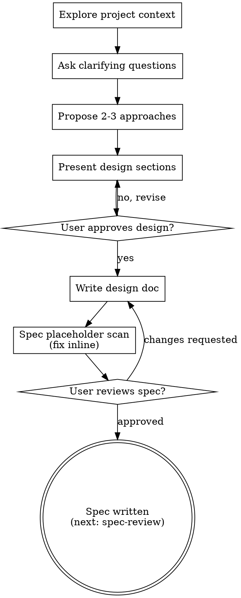

# Spec Writing: Ideas Into Specs

Help turn ideas into fully formed designs and specs through natural collaborative dialogue.

Start from current project context and settled decisions. Ask only unresolved
questions, one at a time. Present changed design choices for approval; consume
valid prior approval rather than repeating it.

Consume already valid design approval and settled research before asking questions.
Do not restart design merely because execution or correction was requested.
Author only the approved spec subject; implementation requires its own grant.

For small requests, state actual consequences and assumptions plainly. A short
design can suffice. An explicitly owner-declined spec remains the ADR-0003
exception, retained in the existing brief, not a missing document to invent.

## Checklist

Use this inline author checklist as intent, not tasks/todos or another progress mirror:

1. **Explore project context**, check files, docs, recent commits. **If a `<slug>-research.md` exists for this effort** (a folder under `docs/specs/` that names it in `meta.yaml`), READ it first and let it seed the design, do not re-investigate what research already settled. When research already answers the design questions, collapse the one-at-a-time dialogue to "confirm the implied design, then write the spec" (see The Process below).
2. **Ask clarifying questions**, one at a time, understand purpose/constraints/success criteria
3. **Propose 2-3 approaches**, with trade-offs and your recommendation
4. **Present design**, scale sections to complexity and resolve only unapproved material choices
5. **Write spec**, into an authorized research-effort folder as `docs/specs/NN-slug/<stream>-spec.md` (create the folder and its `meta.yaml` only within the grant; see "Spec folder & meta.yaml" below). Respect actual tracking/ignore policy; do not auto-commit or add ignore rules.
6. **Spec placeholder scan**, cheap inline check for placeholders and internal contradictions only; the real review is `spec-review` in a fresh subagent (see below)
7. **Spec acceptance**, consume existing approval or ask about unresolved written requirements
8. **Hand off**, the next hop is `spec-review` (a fresh subagent reads what the spec *says*), then `plan-writing`, under coordinator admission. An existing spec receives one independent review. If the owner declined the spec itself, retain that exception and accepted requirements rather than inventing a spec or claiming spec review.

## Process Flow



**The terminal state is the written spec.** After it, the next hop is `spec-review` (a fresh subagent reads what the spec *says*, not what you *meant*), then `plan-writing`. Do NOT invoke frontend-design, mcp-builder, or any other implementation skill, the flow is spec → spec-review → plan-writing → plan-review → build, and successors require coordinator admission within the existing grant.

## The Process

**Understanding the idea:**

- Check out the current project state first (files, docs, recent commits)
- **Seed from research when it exists.** If this effort has a `<slug>-research.md` (a `docs/specs/NN-slug/` folder whose `meta.yaml` names it, typically written by `research-team`), read it before asking anything. Research has already investigated the unknowns; your job here is to author the spec, not to re-run the investigation. Scale the dialogue to how much the research answers:
  - **Research answers the design questions** → consume valid approval already present; otherwise skip the long one-at-a-time interview. Confirm the implied design in one pass ("Here's the design the research points to: …, does that match your intent?"), then go straight to writing the spec. Do not ask questions the research already settled.
  - **Research leaves design questions open** → ask only those, one at a time, in the normal flow below.
  There is no separate "research-seeded" skill, same author, dialogue scaled to input richness.
- Before asking detailed questions, assess scope: if the request describes multiple independent subsystems (e.g., "build a platform with chat, file storage, billing, and analytics"), flag this immediately. Don't spend questions refining details of a project that needs to be decomposed first.
- If the project is too large for a single spec, help the user decompose into sub-projects: what are the independent pieces, how do they relate, what order should they be built? Then brainstorm the first sub-project through the normal design flow. Each sub-project gets its own spec → plan → implementation cycle.
- If the domain is genuinely *unknown* rather than merely large, several independent unknowns that each need investigating before the design is even tractable, offer the heavy path instead of guessing:

  > "This looks broad enough to research in parallel. Want me to run `research-team`, spawn
  > read-only researchers to investigate independent unknowns and return complete evidence
  > for a research synthesis, instead of designing solo?"

  If yes, hand off to the **research-team** skill and return with its research evidence. Otherwise continue the normal design flow. Note this is a different problem from decomposition: decomposition splits work you *understand*, while research-team investigates work you *don't*. A project can need one, both, or neither.
- For appropriately-scoped projects, ask questions one at a time to refine the idea
- Prefer multiple choice questions when possible, but open-ended is fine too
- Only one question per message - if a topic needs more exploration, break it into multiple questions
- Focus on understanding: purpose, constraints, success criteria

**Exploring approaches:**

- Propose 2-3 different approaches with trade-offs
- Present options conversationally with your recommendation and reasoning
- Lead with your recommended option and explain why

**Presenting the design:**

- Once you believe you understand what you're building, present the design
- Scale each section to its complexity: a few sentences if straightforward, up to 200-300 words if nuanced
- Ask about unresolved material choices, not already approved sections
- Cover: architecture, components, data flow, error handling, testing
- Be ready to go back and clarify if something doesn't make sense

**Draw it, don't just describe it:**

When an approach or a design section involves structure, control flow, data flow, or a state
machine, **lead with a compact ASCII diagram** and then the prose. Use the diagram-explain
charset: `+---+` boxes, `=>` sync, `~>` async, `>` `<` `^` `v` arrows, ≤100 columns wide.

The picture is a required complement to the words for any non-trivial structural concept, not an
afterthought. A boundary you cannot draw is usually a boundary you have not yet decided.

**Design for isolation and clarity:**

- Break the system into smaller units that each have one clear purpose, communicate through well-defined interfaces, and can be understood and tested independently
- For each unit, you should be able to answer: what does it do, how do you use it, and what does it depend on?
- Can someone understand what a unit does without reading its internals? Can you change the internals without breaking consumers? If not, the boundaries need work.
- Smaller, well-bounded units are also easier for you to work with - you reason better about code you can hold in context at once, and your edits are more reliable when files are focused. When a file grows large, that's often a signal that it's doing too much.

**Working in existing codebases:**

- Explore the current structure before proposing changes. Follow existing patterns.
- Where existing code has problems that affect the work (e.g., a file that's grown too large, unclear boundaries, tangled responsibilities), include targeted improvements as part of the design - the way a good developer improves code they're working in.
- Don't propose unrelated refactoring. Stay focused on what serves the current goal.

## After the Design

**Stress-test it first (optional):**

Once the user approves the design and before you write the doc, offer to interrogate it:

> "Want me to grill this design first, interrogate the assumptions and the hard questions,
> before we commit it to a spec?"

If yes, run the `grilling` skill, then come back here with what it surfaced. The design is at its
cheapest to change in the moment right before it becomes a document. The user may decline; proceed
either way.

**Documentation:**

- Write the validated design (spec) to `docs/specs/NN-slug/<stream>-spec.md`, where `NN-slug` is a research-effort folder (sequential number + short slug, e.g. `01-user-auth`) and `<stream>` names this stream. Scan `docs/specs/` for the highest existing `NN` and increment.
  - (User preferences for spec location override this default)
- Follow effective project writing guidance inline; authoring does not admit an editorial worker.
- Respect actual repository tracking/ignore policy. A spec write grants no commit, ignore-rule change or publication; perform those only under separate authorization.

**Spec folder & meta.yaml:**

A folder under `docs/specs/` is **one research effort**, and it holds **many streams**. A stream is
**one spec and one plan**, the unit of independently specifiable, reviewable, shippable work. The
folder shares one research doc across all its streams (ADR-0003):

```
docs/specs/NN-slug/                    ← ONE research effort
├── meta.yaml
├── <slug>-research.md                 ← ONE per folder; it is what makes the folder a folder
├── <stream>-spec.md   ┐
├── <stream>-plan.md   ┘               ← ONE stream: exactly one spec, exactly one plan
├── <stream2>-spec.md  ┐
└── <stream2>-plan.md  ┘               ← another stream
```

`NN-slug` is a sequential number + short slug (e.g. `03-payment-retry`). Scan `docs/specs/` for the
highest existing `NN` and increment.

Spec writing designs **one stream**. On first write into a new folder, create `meta.yaml` and
append your stream, naming the spec file you just wrote:

```yaml
slug: NN-slug
intent: "One line: what this investigation is."
created: <today, YYYY-MM-DD>     # from context; do not invent
updated: <today, YYYY-MM-DD>

research: <slug>-research.md     # ONE per folder; present only once research has been written

streams:
  - slug: <stream>              # THE name: <stream>-spec.md, <stream>-plan.md, --tags <stream>
    intent: "One line: what this stream is."
    spec: <stream>-spec.md      # the file you just wrote
    plan: null                  # plan-writing fills this in
    epic: null                  # optional reference only when tk is selected
    tasks: []                   # optional references, not a required progress mirror
```

If `meta.yaml` already exists (e.g. `research-team` created it), append your stream to `streams:` and
bump `updated:`. Each skill fills the fields it produces: `plan-writing` fills `plan:`, and
an explicitly authorized tracker owner fills optional `epic:`/`tasks:` references
only when tk is selected. No automatic seeding or duplicate mutable status.

**One stream = one spec + one plan.** If the work forks into pieces that are independently
specifiable, reviewable, and shippable, that is **more than one stream**, add a stream, not a second
plan to an existing one. They share the folder's one research doc; they share nothing else.

**Name the file; do not assert a flag.** Write `spec: <stream>-spec.md`, never `spec: true`. Naming
the file and claiming it exists are the same act.

**Every stream gets a spec by default.** `spec-review` and `plan-review` are different lenses, *"is
this the right thing to build"* vs *"is this buildable as written"*, so keep both. If the user
explicitly declines a spec, record the decision instead of leaving an absence:

```yaml
  - slug: quick-fix
    intent: "One line."
    spec: null
    spec_declined: "User opted to plan directly (2026-07-12), scope judged too small for a spec."
    plan: quick-fix-plan.md
    epic: null
    tasks: []
```

**The manifest must be checkable, not believable. Two invariants:**

1. Every filename `meta.yaml` names **resolves to a file on disk.**
2. Every `*-spec.md` / `*-plan.md` in the folder **is named in `meta.yaml`.**

Both are greppable, that is why the schema names files rather than asserting flags.

Confirm `docs/specs/` is gitignored before writing into it: `git check-ignore -q docs/specs/ && echo ignored`.
If it is not ignored, report the actual policy and ask before altering .gitignore.
No automatic tracking-policy change or commit. Do not assert it is ignored, check.

**Spec placeholder scan (cheap, inline):**

After writing the spec, scan it for the mechanical failures only, the ones that need no fresh
perspective to catch:

1. **Placeholders:** any "TBD", "TODO", or an empty section? Fill them.
2. **Internal contradictions:** does one section say the opposite of another?

Fix them and move on.

This inline check is not independent spec review. The coordinator admits one
spec-review subject, using its maintained spec-reviewer.md rubric. The retained
spec-document-reviewer-prompt.md is a compatibility pointer to that same rubric,
not a second reviewer. No automatic second model or repeat-until-approved loop.
Read complete findings and use the existing one-batch correction/disposition route.
Material scope/interface/invariant changes or insufficient proof return to the owner.

Consume existing valid spec/design approval. Ask about real unresolved content,
not merely a stage label. Retain explicit review/spec declines in the existing
brief. Missing requirements or authority independently block. Hand off the accepted
spec and exact evidence references to plan-writing only within coordinator
admission, without self-launching successors.

The coordinator selects one mutable progress authority once at plan acceptance.
Run-owning native state wins; otherwise explicit project selection, existing
tracker or one durable plan-associated record. UI todos alone do not outrank it.
Metadata indexes documents and logs retain observations. No checklist-to-todo or
tk mirrors. Read instructions, brief, latest handoff and actual source/results on
resume; do not replay settled research. Ordinary development requires no root
numerical allocation form; applicable host/resource limits remain.
Commit, publication and cleanup require separate grants.

## Key Principles

- **One question at a time** - Don't overwhelm with multiple questions
- **Multiple choice preferred** - Easier to answer than open-ended when possible
- **YAGNI ruthlessly** - Remove unnecessary features from all designs
- **Explore alternatives** - Always propose 2-3 approaches before settling
- **Incremental validation** - Present design, get approval before moving on
- **Be flexible** - Go back and clarify when something doesn't make sense
